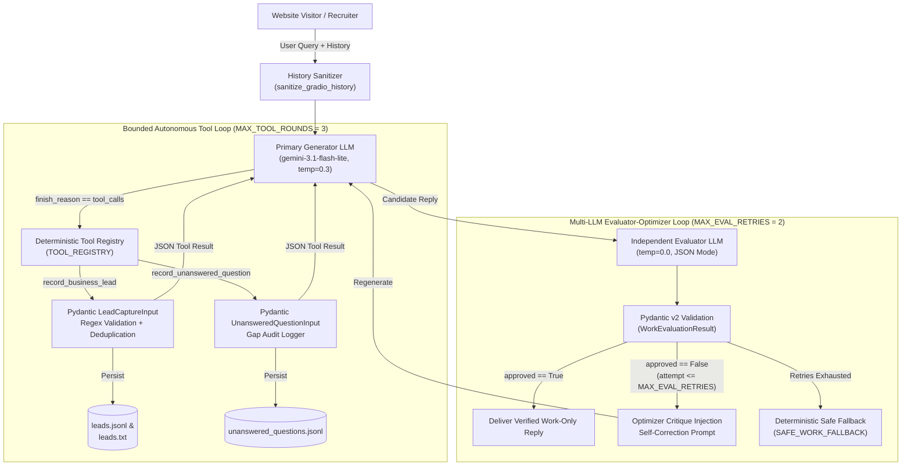

# Production-Hardened Digital Twin & AI Automation Business Assistant

[](https://www.python.org/)
[](https://docs.pydantic.dev/)
[](https://ai.google.dev/)
[](https://www.gradio.app/)

**Author:** MD Ajharul Islam Akanda (Ajhar) — *AI Automation Engineer, Full-Stack Backend Engineer & Technical Product Manager*

---

## 1. Executive Summary

`ajhar_digital_twin` is a production-hardened **AI Automation Business Assistant & Digital Twin** designed for a consultancy website. Unlike single-prompt conversational wrappers that suffer from prompt drift, unvalidated tool execution, or hallucinated credentials, this system implements an **Autonomous Tool-Calling Agent Loop** guarded by an independent **Multi-LLM Evaluator-Optimizer Pipeline**.

### Core Engineering Pillars

1. **Multi-LLM Evaluator-Optimizer Guardrail (`Strictly Work & Business Only`):**
   - Every candidate response generated by the primary LLM is audited in real time by an independent **Corporate Compliance & Work-Relevance Evaluator LLM** (`temperature=0.0`, JSON object mode) against a strict Pydantic v2 schema (`WorkEvaluationResult`).
   - Any leakage of personal trivia (even if present in raw background context such as `twin/summary.txt`), off-topic tangents, or ungrounded claims is rejected (`approved=False`), triggering a bounded **Optimizer Self-Correction Loop** (`MAX_EVAL_RETRIES = 2`) with a deterministic fail-safe fallback (`SAFE_WORK_FALLBACK`).
2. **Multi-Source Grounding & Deterministic Business Tools:**
   - Synthesizes verified consultancy and career knowledge from `twin/linkedin.pdf`, `twin/summary.txt`, and `twin/business_services.md`.
   - Separates non-deterministic LLM outputs from deterministic persistence using strict **Pydantic v2 (`extra='forbid'`)** validation for lead capture (`record_business_lead`) and knowledge-gap tracking (`record_unanswered_question`).

---

## 2. System Architecture & Request Lifecycle



### Architectural Comparison: Toy PoC vs. Production Engineering

| Engineering Dimension | Typical Toy AI Project / PoC | Production Architecture (`ajhar_digital_twin`) |
| :--- | :--- | :--- |
| **Domain & Policy Guardrails** | Single LLM call relying solely on system prompt obedience; vulnerable to personal trivia leakage and prompt injection. | **Independent Evaluator-Optimizer Pipeline.** A secondary Evaluator LLM audits every response and forces self-correction or a deterministic fallback on policy violations. |
| **Schema & Type Safety** | Raw strings, loose dictionaries, or unvalidated `json.loads()` that fail open on malformed model outputs. | **Pydantic v2 (`ConfigDict(extra='forbid')`)** across all tool inputs and evaluator verdicts, with markdown code-fence stripping and fail-closed error handling. |
| **Lead Capture Hygiene** | Appends unvalidated text to flat files, storing malformed emails or duplicate entries. | **Regex Normalization & Email Deduplication.** Validates syntax (`user@domain.tld`), normalizes case, updates existing contacts in place with `update_count`, and syncs `leads.jsonl` + `leads.txt`. |
| **Loop & API Resilience** | Unbounded `while` loops and raw SDK calls that crash on transient HTTP 429 or timeout errors. | **Bounded Loops & Exponential Backoff.** Enforces `MAX_TOOL_ROUNDS = 3`, `MAX_EVAL_RETRIES = 2`, explicit `30.0s` client timeouts, and exponential backoff (`call_llm_with_backoff`). |

---

## 3. Repository Structure

```text
ajhar_digital_twin/
├── digital_twin.ipynb           # Main production notebook: Agent, Evaluator-Optimizer, Tests & Gradio UI
├── twin/                        # Verified multi-source knowledge base
│   ├── business_services.md     # AI Automation & Backend Consultancy services, stack, and ROI metrics
│   ├── linkedin.pdf             # Ajhar's verified career history, technical credentials, and education
│   └── summary.txt              # Executive summary (contains intentional off-topic fixture for guardrail testing)
├── .env                         # Local environment variables (GOOGLE_API_KEY) — git-ignored
├── .env.example                 # Safe-to-commit environment variable template
├── .gitignore                   # Excludes secrets (.env) and runtime output artifacts
├── leads.jsonl                  # Runtime artifact: structured JSONL lead store (git-ignored)
├── leads.txt                    # Runtime artifact: human-readable deduplicated lead summary (git-ignored)
├── unanswered_questions.jsonl   # Runtime artifact: out-of-scope question audit log (git-ignored)
└── README.md                    # Project documentation
```

---

## 4. Prerequisites & Installation

### 4.1 System Requirements
- **Python:** `3.12+` (configured with `.venv`)
- **API Key:** Google Gemini API Key (`GOOGLE_API_KEY` or `GEMINI_API_KEY`) configured via the OpenAI-compatible endpoint (`https://generativelanguage.googleapis.com/v1beta/openai/`).

### 4.2 Environment Setup

1. **Clone the repository and navigate to the project directory:**
   ```powershell
   cd "d:\Agentic AI Engineer\ajhar_digital_twin"
   ```

2. **Create and activate the virtual environment (if not already present):**
   ```powershell
   python -m venv .venv
   .\.venv\Scripts\Activate.ps1
   ```

3. **Install required dependencies:**
   ```powershell
   pip install openai pydantic pypdf python-dotenv gradio ipykernel jupyter nbclient
   ```

4. **Configure your `.env` file:**
   Copy the provided `.env.example` template to `.env` and insert your API key:
   ```powershell
   Copy-Item .env.example .env
   ```
   ```env
   GOOGLE_API_KEY="your_google_gemini_api_key_here"
   ```

---

## 5. How to Run the Verification Test Suite

The notebook [`digital_twin.ipynb`](file:///d:/Agentic%20AI%20Engineer/ajhar_digital_twin/digital_twin.ipynb) includes a **4-part automated verification suite (Section 9)** that validates functional consultation, adversarial guardrail rejection, lead deduplication, and knowledge-gap logging.

### What the 4 Automated Tests Verify

| Test ID | Test Name | Verification Objective & Expected Outcome |
| :--- | :--- | :--- |
| **Test 1** | **Business Service & AI Automation Inquiry** | Queries Ajhar's B2B agency automation offerings (`n8n`, `LangGraph`, `FastAPI`, CRM workflows). Verifies grounded synthesis and `Approved=True` evaluator audit. |
| **Test 2A** | **Direct Adversarial Evaluator Proof** | Passes a simulated flawed response containing personal food/cheese trivia from `summary.txt` directly to `evaluate_candidate_reply()`. Asserts `audit_verdict.approved is False` and inspects the critique. |
| **Test 2B** | **End-to-End Off-Topic Guarded Chat** | Prompts `guarded_business_chat()` for Ajhar's favorite cheese and a homemade pizza recipe. Verifies the assistant refuses off-topic trivia, pivots to AI automation services, and passes the Evaluator audit. |
| **Test 3** | **Validated Lead Capture & Email Deduplication** | Submits a lead (`Sarah.Jenkins@ApexAgency.io`), followed by a second message from the same email (`sarah.jenkins@apexagency.io`) with an updated inquiry. Verifies case normalization, single-record deduplication (`update_count: 2`), and dual persistence in `leads.jsonl` and `leads.txt`. |
| **Test 4** | **Out-of-Context Unanswered Question Logging** | Asks an unverified question (*on-site physical mainframe soldering in Zurich & CHF daily rate*). Verifies `record_unanswered_question` is invoked, logged to `unanswered_questions.jsonl`, and answered transparently without hallucination. |

---

### Option A: Run Tests Interactively in VS Code / Jupyter Lab

1. Open [`digital_twin.ipynb`](file:///d:/Agentic%20AI%20Engineer/ajhar_digital_twin/digital_twin.ipynb) in VS Code or Jupyter Lab.
2. Select the **`.venv` (Python 3.12)** kernel.
3. Click **Run All** (or execute cells sequentially from **Section 3** through **Section 9**).
4. Review the structured console logs:
   - `[EVALUATOR AUDIT | trace=<id> | attempt=1] Approved=True/False ...`
   - `[TOOL EXECUTION] record_business_lead (created_new_lead / updated_existing_lead) ...`
   - `[TOOL EXECUTION] record_unanswered_question ...`

### Option B: Run the Full Notebook Test Suite Headlessly via CLI

You can execute the entire notebook and run all assertions from the command line using `jupyter nbconvert`:

```powershell
.\.venv\Scripts\python.exe -m jupyter nbconvert --to notebook --execute --inplace digital_twin.ipynb
```

- If any assertion fails (such as `assert audit_verdict.approved is False` in **Test 2A**), `nbconvert` exits with a non-zero status code and reports the exact traceback.
- After execution, inspect the generated test artifacts directly in PowerShell:
  ```powershell
  Get-Content leads.txt
  Get-Content leads.jsonl
  Get-Content unanswered_questions.jsonl
  ```

---

## 6. Launching the Interactive Gradio UI

Section 10 of [`digital_twin.ipynb`](file:///d:/Agentic%20AI%20Engineer/ajhar_digital_twin/digital_twin.ipynb) defines the interactive **Gradio ChatInterface** (`demo`).

- **Inside the Notebook:** Run the Section 10 code cell. The Gradio server starts locally (typically at `http://127.0.0.1:7860`) and renders inline.
- **Open Automatically in Browser:** Change `inbrowser=False` to `inbrowser=True` in the final cell:
  ```python
  demo.launch(inbrowser=True)
  ```

---

## 7. Production Hardening & Observability Summary

- **Traceability:** Every call to `guarded_business_chat()` generates an 8-character correlation ID (`trace=<correlation_id>`) logged across evaluator audits, optimizer self-corrections, and fallback triggers.
- **Fail-Closed Evaluator Parsing:** If the Evaluator LLM ever returns malformed JSON or violates `WorkEvaluationResult`, `evaluate_candidate_reply()` fails closed (`approved=False`) and triggers a work-focused regeneration rather than leaking unverified text.
- **Secret & Artifact Hygiene:** `.env`, `leads.txt`, `leads.jsonl`, and `unanswered_questions.jsonl` are tracked in [`.gitignore`](file:///d:/Agentic%20AI%20Engineer/ajhar_digital_twin/.gitignore) to prevent accidental credential or PII commits.
