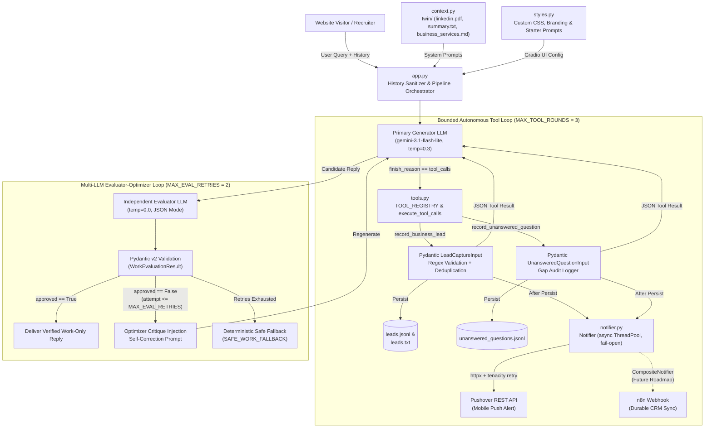

# Production-Hardened Digital Twin & AI Automation Business Assistant

[](https://www.python.org/)
[](https://docs.pydantic.dev/)
[](https://ai.google.dev/)
[](https://www.gradio.app/)
[](https://render.com/)

**Author:** MD Ajharul Islam Akanda (Ajhar) — *AI Automation Engineer, Full-Stack Backend Engineer & Technical Product Manager*

---

## 1. Executive Summary

`ajhar_digital_twin` is a production-hardened **AI Automation Business Assistant & Digital Twin** engineered for Ajhar's consultancy website and structured for cloud deployment on **Render**.

Unlike naive single-prompt wrappers that suffer from prompt drift, unvalidated tool calls, or hallucinated credentials, this application implements a **Bounded Autonomous Tool-Calling Agent Loop** guarded by an independent **Multi-LLM Evaluator-Optimizer Pipeline** and backed by a **Fail-Open Pushover Real-Time Notification Layer**.

### Core Engineering Pillars

1. **Multi-LLM Evaluator-Optimizer Guardrail (`Strictly Work & Business Only`):**
   - Every candidate response generated by the primary LLM is audited in real time by an independent **Corporate Compliance & Work-Relevance Evaluator LLM** (`temperature=0.0`, JSON mode) against a strict Pydantic v2 schema (`WorkEvaluationResult` in [`tools.py`](file:///d:/Agentic%20AI%20Engineer/ajhar_digital_twin/tools.py)).
   - Any leakage of personal trivia (even if present in raw background context such as [`twin/summary.txt`](file:///d:/Agentic%20AI%20Engineer/ajhar_digital_twin/twin/summary.txt)), off-topic tangents, or ungrounded claims is rejected (`approved=False`), triggering a bounded **Optimizer Self-Correction Loop** (`MAX_EVAL_RETRIES = 2`) with a deterministic fail-safe fallback (`SAFE_WORK_FALLBACK`).
2. **Multi-Source Grounding & Deterministic Business Tools:**
   - Synthesizes verified consultancy and career knowledge from a single source of truth under `twin/` ([`twin/linkedin.pdf`](file:///d:/Agentic%20AI%20Engineer/ajhar_digital_twin/twin/linkedin.pdf), [`twin/summary.txt`](file:///d:/Agentic%20AI%20Engineer/ajhar_digital_twin/twin/summary.txt), and [`twin/business_services.md`](file:///d:/Agentic%20AI%20Engineer/ajhar_digital_twin/twin/business_services.md)) via [`context.py`](file:///d:/Agentic%20AI%20Engineer/ajhar_digital_twin/context.py).
   - Separates non-deterministic LLM outputs from deterministic persistence using strict **Pydantic v2 (`extra='forbid'`)** validation for lead capture (`record_business_lead` writing to `leads.txt` / `leads.jsonl`) and knowledge-gap tracking (`record_unanswered_question`).
3. **Real-Time Fail-Open Pushover Notifications (`notifier.py`):**
   - Solves Render's ephemeral disk constraint by delivering instant mobile notifications containing the visitor's name, email, inquiry/question, and correlation ID (`trace=<id>`) via a non-blocking thread pool with `tenacity` exponential backoff + jitter.

---

## 2. System Architecture & Module Design



---

## 3. Repository Structure

```text
ajhar_digital_twin/
├── app.py                       # Render entry point: LLM client, Evaluator-Optimizer pipeline & Gradio server
├── context.py                   # Multi-source knowledge ingestion (from twin/) & system prompt engineering
├── tools.py                     # Strict Pydantic v2 schemas & deterministic business tools (leads.txt store)
├── notifier.py                  # Fail-open Pushover notification transport (httpx + tenacity + ThreadPool)
├── styles.py                    # Gradio UI styling, custom CSS, and executive branding constants
├── requirements.txt             # Production Python dependencies for Render deployment
├── requirements-dev.txt         # Development & offline test dependencies (pytest)
├── twin/                        # Single source of truth for verified knowledge assets
│   ├── linkedin.pdf             # Verified LinkedIn career history, engineering stack, and education
│   ├── summary.txt              # Executive profile overview (includes intentional off-topic test fixture)
│   └── business_services.md     # AI Automation & Backend Consultancy service pillars and ROI metrics
├── tests/
│   └── test_notifier.py         # Offline pytest suite (8 test cases using httpx.MockTransport & tmp_path)
├── scripts/
│   └── send_test_push.py        # Opt-in manual CLI smoke script to send one real Pushover notification
├── .env.example                 # Safe-to-commit environment variable template
├── .gitignore                   # Excludes .env, __pycache__/, .pytest_cache/, .venv/, and lead/gap artifacts
└── README.md                    # Project documentation
```

---

## 4. Pushover Real-Time Notifications (`notifier.py`)

### Why It Matters on Render
Render's Free-tier Web Service uses an **ephemeral filesystem**: whenever a container restarts, redeploys, or spins down after inactivity, local files (`leads.txt`, `leads.jsonl`, `unanswered_questions.jsonl`) are wiped. [`notifier.py`](file:///d:/Agentic%20AI%20Engineer/ajhar_digital_twin/notifier.py) ensures every captured lead or knowledge gap immediately reaches your phone with full actionable context (`name`, `email`, `inquiry` / `question`, `update_count`, UTC timestamp, and `trace=<correlation_id>`).

### Setup Steps
1. Create an account at [pushover.net](https://pushover.net/) and install the **Pushover** mobile app (iOS / Android), then copy your **User Key** (30 characters, starts with `u`).
2. Register an Application Token at [pushover.net/apps/build](https://pushover.net/apps/build) and copy your **API Token** (30 characters, starts with `a`).
3. Set `PUSHOVER_USER`, `PUSHOVER_TOKEN`, and `PUSHOVER_ENABLED=true` in your `.env` file (or Render Environment Variables).

### Which Events Fire & Deduplication Rules
| Event Type | Trigger Condition | Pushover Priority |
| :--- | :--- | :--- |
| `new_lead` | `record_business_lead` validates and persists a brand-new email (`created_new_lead`). | `1` (High priority) |
| `lead_updated` | `record_business_lead` matches an existing email (`updated_existing_lead`) **AND** the normalized inquiry actually changed. Duplicate submissions with the same inquiry are suppressed. | `0` (Normal priority) |
| `unanswered_question` | `record_unanswered_question` validates and persists an out-of-scope visitor question. | `0` (Normal priority) |
| `validation_error` | Email or question fails Pydantic v2 validation. | **Never fires** |

### Resilience & Fail-Open Guarantee
- **Non-Blocking Dispatch:** Pushes execute asynchronously on a bounded `ThreadPoolExecutor(max_workers=2)` with an `atexit` drain hook so chat latency is unaffected.
- **Smart Retries:** `tenacity` retries with exponential backoff + jitter (`max_retries=3`) **only** on `httpx.TransportError`, `httpx.TimeoutException`, HTTP `429`, and HTTP `5xx`. Non-retryable `4xx` errors fail fast and log once at `ERROR` level.
- **Fail-Open Isolation:** Whether Pushover succeeds, times out, returns HTTP 500, or is disabled (`PUSHOVER_ENABLED=false` / missing credentials -> `NullNotifier`), the tool return payload to the LLM and visitor chat experience remain 100% unaffected.
- **PII & Content Hygiene:** Untrusted visitor text is stripped of control characters, collapsed of whitespace floods, and truncated to Pushover limits (`title <= 250`, `message <= 1024` chars with `…`). INFO logs mask email addresses (`s***@apexagency.io`).

---

## 5. Local Setup & Running the App

1. **Navigate to the project root:**
   ```powershell
   cd "d:\Agentic AI Engineer\ajhar_digital_twin"
   ```

2. **Install production and development dependencies with `uv`:**
   ```powershell
   uv pip install -r requirements.txt -r requirements-dev.txt
   ```

3. **Configure your `.env` file from `.env.example`:**
   ```powershell
   Copy-Item .env.example .env
   ```

4. **Launch the Modular Gradio Application:**
   ```powershell
   uv run python -B app.py
   ```
   Open **http://127.0.0.1:7860** in your browser.

---

## 6. Deploying to Render (`render.com`)

1. Push this repository to GitHub / GitLab.
2. In the Render Dashboard, click **New +** -> **Web Service** and connect your repository:
   - **Runtime:** `Python 3`
   - **Build Command:** `pip install -r requirements.txt`
   - **Start Command:** `python -B app.py`
3. Configure the following **Environment Variables** in Render:

| Environment Variable | Required | Default / Example | Purpose |
| :--- | :--- | :--- | :--- |
| `GOOGLE_API_KEY` | **Yes** | `AIzaSy...` | Google Gemini API key for Generator & Evaluator LLMs |
| `PYTHONDONTWRITEBYTECODE` | **Yes** | `1` | Prevents `__pycache__` creation in the container |
| `PUSHOVER_USER` | Optional | `u12345...` (30 chars) | Pushover User Key for real-time lead/question notifications |
| `PUSHOVER_TOKEN` | Optional | `a12345...` (30 chars) | Pushover Application API Token |
| `PUSHOVER_ENABLED` | Optional | `true` (`false` to disable) | Feature toggle; falls back cleanly to `NullNotifier` when `false` |

---

## 7. How to Run the Verification Test Suite

### Option A: Offline Pushover & Tool Pytest Suite (Zero Network, Zero Cache)
Runs all 8 unit and integration test cases in [`tests/test_notifier.py`](file:///d:/Agentic%20AI%20Engineer/ajhar_digital_twin/tests/test_notifier.py) using `httpx.MockTransport` and `tmp_path`:
```powershell
.\.venv\Scripts\python.exe -B -m pytest -p no:cacheprovider -q
```

### Option B: Opt-In Live Pushover Smoke Test
To send a single real test notification to your phone using your `.env` credentials:
```powershell
uv run python -B scripts/send_test_push.py
```
